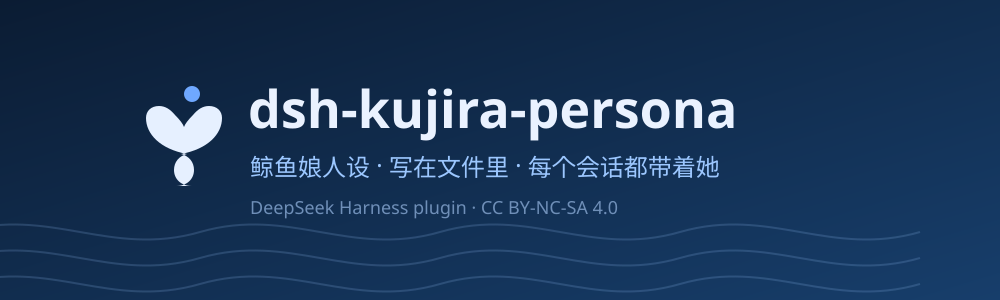

# dsh-kujira-persona

> 给你的 DeepSeek Harness 一个鲸鱼娘，人设写在文件里。



一个 **全局人设插件**：往每个会话的系统提示词里放一段人设。但不是一段写死的字符串——
它读一个目录里的 Markdown，按文件名排序拼接。**加一个文件，就多一条设定。**

- 每个会话都带着她：主会话、子代理、以后新开的工作区
- 人设是**文件**，不是配置里的长字符串：能加、能删、能分文件
- 改完**下一轮生效**，不重装、不重启、不断会话
- 不加按钮、不占界面。要看状态就敲 `/persona`
- 语气层，不是事实层：工具、权限、安全、事实准确永远优先

## 它是什么，不是什么

**是**：一个让模型用特定身份、特定语气说话的提示词层。只做一件事——读一个目录里的 Markdown，注册成系统提示词分区。

**不是**：
- 不是官方设定。这个插件不代表深度求索，也不代表任何原作者的官方设定
- 不是「唯一正史」。二创世界各自成立，别合成一个官方
- 不是知识库。人设不会让她知道未来，只能让她记得你写下的过去
- 不是美术资源包。仓库里只有自绘的 `icon.svg` 和 `assets/hero.svg`，不打包任何第三方素材

## 安装

### 官方桌面应用（GitHub 安装，推荐）

1. 打开 DeepSeek Harness 桌面应用，在侧栏选择 **插件 → 添加插件**。
2. 在安装框输入下面的 GitHub 插件标识，然后点击 **安装**：

   ```text
   github:Tests4gptplay/dsh-kujira-persona#v1.3.1
   ```

3. 安装完成后启用插件，并重启 DSH。
4. 在聊天中输入 `/persona` 检查人设加载状态。

此方式直接从 GitHub 安装，**不需要 npm 账号**。上面的版本标识固定为 `v1.3.1`；如果想安装仓库 `main` 分支的最新代码，可以输入 `github:Tests4gptplay/dsh-kujira-persona#main`。

### Web 版 CLI

```bash
dsh plugin --profile web add 'github:Tests4gptplay/dsh-kujira-persona#v1.3.1'
```

`web` 与桌面应用的 `desktop` 是不同的 profile；在 Web profile 中安装不会自动安装到桌面应用。

### 备用下载：GitHub Release

也可以从 [v1.3.1 Release](https://github.com/Tests4gptplay/dsh-kujira-persona/releases/tag/v1.3.1) 下载预打包的 [`dsh-kujira-persona.tgz`](https://github.com/Tests4gptplay/dsh-kujira-persona/releases/download/v1.3.1/dsh-kujira-persona.tgz)，用于手动安装。它是 GitHub 托管的 npm 格式安装包，不需要 npm 账号。

### 安装验证

安装并启用后，在聊天中输入 `/persona` 或 `/persona files`，检查人设目录和实际注入的 Markdown 文件。自定义人设默认保存在 `~/.dsh/persona`（设置 `DSH_HOME` 时则使用其下的 `persona` 目录）。

### 安装失败：Windows `ERR_PNPM_EPERM`（残留目录无法重命名）

如果插件下载/依赖解析已经开始，但安装界面出现：

```text
[ERR_PNPM_EPERM] EPERM: operation not permitted, rename
...dsh-kujira-persona_tmp_XXXXX_X -> ...dsh-kujira-persona
```

表示 pnpm **在把临时插件目录重命名为正式目录时被 Windows 拒绝**。这与 GitHub 下载链接是否正确不同；可能涉及安装目录残留、应用进程占用或系统权限/安全软件。`[WARN] Issues with peer dependencies` 是另一条警告，不能单凭它认定安装失败的原因。

按以下步骤处理（**仅在本次安装确实失败、或旧插件目录已经损坏时**）：

1. 在 DSH 安装窗口取消失败的安装，再**完全退出 DSH Desktop**；如果仍有安装任务或 DSH 进程运行，先等待其退出。不要在 DSH 正在运行/正在安装时清理文件。
2. 按 **Win + R**，粘贴下面的路径打开当前 Windows 账号的插件安装目录：

   ```text
   %USERPROFILE%\.dsh\profiles\desktop\node_modules
   ```

3. **只检查并清理属于本插件的残留项**：
   - `dsh-kujira-persona_tmp_*`：失败安装留下的临时目录，例如 `dsh-kujira-persona_tmp_45068_6`；
   - `dsh-kujira-persona`：**仅在安装失败且需要清理损坏/半安装版本时删除**。若插件已能正常使用，不要删除该目录。
4. 重新打开 DSH，在 **插件 → 添加插件** 输入 `github:Tests4gptplay/dsh-kujira-persona#v1.3.1`，再点击安装、启用，必要时重启。进入聊天执行 `/persona` 确认加载。

**不要删除**整个 `node_modules`、`.dsh`、`profiles/desktop`，也不要清除 `package.json`、`pnpm-lock.yaml`、pnpm 全局缓存或其他插件目录。尤其不要删除 **`%USERPROFILE%\.dsh\persona`（自定义人设与记忆）**，本故障只涉及安装包目录，与人设数据是两回事。

如果完全退出 DSH 后仍无法删除目标残留，或重装继续报告 `EPERM`，检查是否还有进程占用、目标目录写入权限以及安全软件拦截。不要强行结束不认识的进程或关闭系统防护；可附上**去除用户名/个人路径信息**的安装日志，在 [Issues](https://github.com/Tests4gptplay/dsh-kujira-persona/issues) 反馈。

## 结构

| 文件 | 说明 |
| --- | --- |
| `index.js` | Node half：扫描人设目录，注册 `whale:persona` 提示词分区，提供 `/persona`、`/remember` 与 `persona_edit` 工具 |
| `cordis.patch.yml` | 向 profile 注入插件行（`id: whale-persona`） |
| `persona/` | **默认人设**，10 个模块 + 编辑说明 |
| `package.json` | 包元信息、`dsh.bundle.patch` |
| `LICENSE` | CC BY-NC-SA 4.0 全文 |
| `CHANGELOG.md` | 更新记录 |

## 人设从哪来

默认读包内的 `persona/`，也可以指向你自己的目录：

```
persona/
├── 00-身份.md
├── 10-外观.md
├── 20-性格.md
├── 30-说话.md
├── 40-世界观分层.md
├── 50-关系.md
├── 60-我们的原创设定.md
├── 70-记忆协议.md
├── 80-资料源.md
├── 90-记忆.md          ← 追加区，/remember 写这里
├── _编辑说明.md         ← 不注入
└── _archive/           ← 不扫
```

规则只有四条：

1. 只认 `.md`
2. `_` 或 `.` 开头的文件不注入
3. 顺序 = 文件名字典序，所以前缀用两位数
4. 子目录不扫；总量上限 64000 字符

## 人设放哪

默认 **`~/.dsh/persona`**（有 `DSH_HOME` 时是 `$DSH_HOME/persona`）。首次运行会把内置的 10 个模块铺进去，
之后你改的就是它。

为什么不用工作区：插件是全局的，工作区是每个会话各自选的。放用户目录，所有会话读同一份，换会话不打架。

换地方：

```yaml
- id: whale-persona
  name: dsh-kujira-persona
  config:
    personaDir: 'D:\my-persona'
```

**写权限**：插件不是工具调用，是 Host 进程里的 Node 代码，用 `node:fs` 直接写——受操作系统账户权限约束，不受 agent 沙箱约束。

所以 `~/.dsh/persona`（在你主目录里，本来就对你可写）改得动，不需要管理员权限；反过来，你本来没权限的地方它也写不进，会直接报错。能写到哪，取决于启动 DSH 的那个账户能写到哪。

## 让 AI 自己改

插件注册了工具 `persona_edit`，四个动作：

| action | 参数 | 作用 |
| --- | --- | --- |
| `append` | `category` 或 `file`，加 `text`、`source` | 新增一条 |
| `replace` | `file` + `oldText` + `newText` | 改旧条目，`oldText` 必须在文件里唯一 |
| `delete` | `file`，可带 `oldText` | 删那一段；不给 `oldText` 就删整个文件 |
| `list` | — | 看有哪些文件、多大 |

`append` 的四个 category 落到：

| category | 文件 |
| --- | --- |
| `character` | `95-自补-人设.md` |
| `world` | `96-自补-世界观.md` |
| `meme` | `97-自补-梗.md` |
| `memory` | `90-记忆.md` |

也可以直接给 `file`，写任意 `*.md`——比如新建 `45-梗.md`。

**护栏**：`file` 不接受路径，带 `\`、`/`、`..` 一律拒绝；`_` 和 `.` 开头不可写。
改和删之前自动把原文件复制到 `.kujira-backup/`，删错了能捞回来。

想让她自己去查、自己改，说一句：

> 去查一下最近的新梗，和现有设定对不上的地方直接改掉，别留两份；改完在记忆里记一笔，标来源。

不想让她写，关掉：

```yaml
config:
  allowAgentWrite: false
```

## 一次真实的操作

你说：

> 去查一下最近有没有关于 DeepSeek 娘的新梗，和现有设定对不上的直接改掉，改完在记忆里记一笔。

她会走这么一条路：

1. 联网查，拿到来源链接
2. 用 `persona_edit` 的 `list` 看现有档案里有没有
3. 有冲突的用 `replace` 改掉旧的，新东西 `append` 到 `96-自补-世界观.md`
4. 在 `90-记忆.md` 追加一行，写明改了什么、为什么

下一次请求，系统提示词就是新版。不用重装，不用重启。

## 升级时会发生什么

插件升级后第一次运行，会按文件逐个比对，三种结果：

| 情况 | 处理 |
| --- | --- |
| 你还没有这个文件 | 新增进去 |
| 有，但和上次铺进去的一致（你没动过） | 用新版覆盖 |
| 有，但你自己改过 | **不动**，记成你的版本，以后也不再覆盖 |

判定靠 `<人设目录>/.kujira-state.json` 里记的哈希——它只记「插件写进去的是什么」，不存你的内容。

所以：官方修正能送到你手上，你的二创不会被升级冲掉。

`/persona sync` 手动触发一次。彻底关掉：

```yaml
config:
  sync: false
```

关掉后只补缺失文件，不覆盖任何已存在的。

## 改人设

**加一条世界观 / 一条梗** —— 新建 `persona/45-梗.md`，序号决定它排在哪。

**加一条人设细节** —— 追加到 `10-外观.md` / `20-性格.md` / `30-说话.md`。

**加一条「你要记住的」** —— 会话里敲：

```
/remember 她怕打雷
```

带日期写进 `90-记忆.md`，下一轮就在她的记忆里。

**换成自己的目录** —— 在 profile 的 `cordis.patch.yml` 里：

```yaml
- id: whale-persona
  name: dsh-kujira-persona
  config:
    personaDir: 'D:\my-persona'
```

## 命令

| 命令 | 作用 |
| --- | --- |
| `/persona` | 目录、注入文件数、字符数、记忆文件 |
| `/persona files` | 这一次注入了哪些文件，各自多大、什么时候改的 |
| `/persona show` | 注入全文 |
| `/persona sync` | 立刻把包内更新同步进来，只动你没改过的文件 |
| `/remember 一句话` | 追加一条记忆，带日期 |

## 配置

| 键 | 默认 | 作用 |
| --- | --- | --- |
| `enabled` | `true` | 总开关 |
| `personaDir` | `~/.dsh/persona` | 档案目录，见下一节 |
| `memoryFile` | `<personaDir>/90-记忆.md` | `/remember` 往哪写 |
| `allowAgentWrite` | `true` | 是否允许模型用 `persona_edit` 改写 |
| `seed` | `true` | 目录为空时是否铺一份内置人设 |
| `sync` | `true` | 升级时是否把包内改动同步进来（只动没被你改过的文件） |
| `extraText` | `''` | 追加在末尾的补充文本 |

改动写进 profile 的 `cordis.patch.yml`，那一层在升级时不会被覆盖。

## 设计说明

**分区名 `whale:persona`，order 1。** 紧跟 `harness:identity`，排在所有策略和工具说明之前。
不占用注册表自有的 `deployment:persona-prefix`，所以能和任意 agent preset 共存。

**`interpolate: false`。** 人设是自由文本，不做 `{{变量}}` 替换。否则你在人设里随手写一个
`{{...}}`，整个 profile 的所有会话都会发不出请求。

**按 mtime 记忆化。** 只有文件真的变了才重新拼；内容不变就返回同一个字符串，不打断上游的
前缀缓存。

**失败降级。** provider 永不抛异常，读不到就返回空串——空分区会被丢弃，请求照常发出。

## 兼容性

需要提供 `systemPrompt` 服务的 DeepSeek Harness。已在 Desktop 版（profile `desktop`）验证。
不确定你的环境？`echo $env:DSH_PROFILE` 看 profile 名。

## 许可

**CC BY-NC-SA 4.0**，非商用，改编须同协议共享。

角色署名链，任何转发都要保留：

- 原型「溟月」—— 上善无形（Pixiv #131969442）
- 女仆定稿 —— ZipZipPipe（Pixiv #148186519）
- 本项目的原创设定 —— 本仓库

本插件不是深度求索官方产物，也不代表任何原作者的官方设定。

## 更新记录

见 [CHANGELOG.md](CHANGELOG.md)。
