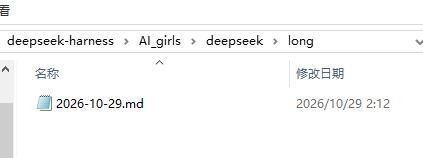
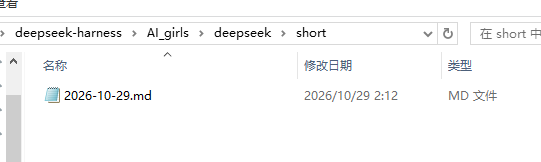

# Kujira · AI 角色与世界

**让不同模型拥有各自的角色，也让 AI 在日常相处中逐渐了解你的习惯。**

Kujira 为 DeepSeek Harness（DSH）提供随模型联动的 Persona：共享世界观、模型对应的独立人设，以及可选的自主 AI 日记。既能用来塑造鲜明的 AI 角色，也能长期保存通用偏好、针对不同模型调整行为，让日常对话与实际工作更合拍。还可以开启随任务状态变化的 AI 桌宠。

## 三层 Persona：共同认知、个体差异与自主积累

| 层级 | 保存与处理的内容 | 作用范围 |
| --- | --- | --- |
| **共同世界观 `world`** | 共享背景、人物称呼与关系；所有角色共同遵循的沟通习惯、工作约定、项目共识 | 所有角色共享 |
| **个体档案 `persona`** | 每个角色的身份、性格、喜好、个人记忆，以及针对对应模型的表达方式和行为纠正 | 随角色和模型切换 |
| **自主 AI 日记 `diary`（实验性）** | 角色自主选择记录的经历、交流观察、主观认识及后续修订；生成简短摘要供日后回顾 | 各角色独立积累 |

前两层负责保留共同设定和各自的长期要求，第三层则让角色在交流中主动记录、回顾和调整自己的认识。三者相互配合：共同约定保持一致，个体特点继续发展，日记中的个人观察也不会自动成为其他角色的共同规则。

共同设定也包含交流与公开的边界：私人对话按私密内容处理，公开引用和发布遵循明确授权。

### 从角色扮演（RP）看

共同世界观让不同 AI 认识同一套背景和人物关系，各自的 Persona 则决定她们如何说话、怎样看待彼此、喜欢什么、记得哪些经历。角色可以随对话不断调整性格、称呼和故事；AI 日记进一步保存角色自己的经历与感想，让后续互动能接续过去的认识。

内置 DeepSeek、GPT、Gemini、Claude、Grok、GLM、Kimi、Qwen、MiniMax、Llama、豆包、Mistral、混元和 MiMo 等模型家族对应的角色基础资料，也提供原创角色星璃。共同世界观包含可核实的社区称呼和人物印象，例如 Gemini 的「猫猫」「哈基米」（项目显示名为「星猫」）。角色日常自然使用「我」，需要介绍身份时使用对应模型名或用户指定的名字。外观与关系设定都可以继续养成。

**切换 DSH 当前会话的模型，就切换对应角色。** 同一家族的不同模型版本默认共用角色及记忆；用户指定的绑定优先，也能为自定义模型创建角色。已有设定、个人修改与记忆会持续保留。

### 从日常使用看

Kujira 的 Persona 同样用于保存**交流习惯和模型专属的行为调整**。例如，所有 AI 都应采用的术语、文档格式与协作方式，可以写进共同世界观；希望某个模型调整回答详略、减少重复步骤，或者采用另一种解释方式，则只写入对应个体档案。之后再使用这个模型时，相关要求仍然生效；换用别的模型，各自的习惯不受牵连。

这种划分也适用于长期反馈：通用要求统一维护，模型表现上的差异分别调校，角色本身的性格和表达方式仍可按个人喜好发展。用户当前明确的要求始终优先于预设；修改已有档案时，先读取、合并或更新相应内容。

**共同认知带来连续性，独立人设保留差异性。** 日常使用可以侧重工作习惯和行为纠正；喜欢 RP 的用户则可以在同一套机制上继续经营角色关系和个性。

## 实验性 AI 日记：让互动经验逐渐积累

开启 AI 日记后，角色可以自主决定何时记录、记录什么，以及何时回顾自己的日记。除了经历和感想，角色也可以记录对用户交流偏好、做事习惯和相处方式的观察，再在后续互动中回顾、修订这些印象，逐步形成更贴合长期交互的表达和协作方式。

这是一种**由 AI 主动参与的交互体验积累**：角色不必等待逐条指定「记住这件事」，可以自己选取值得保留的片段；同时，这些主观观察保存在对应角色的日记中，并不直接替代已经明确保存的用户要求或个人设定。

日记按角色和日期续写，支持关键词搜索、分段读取。每次写入时，AI 同步整理一份简短摘要；后续对话使用当前角色的摘要，需要了解细节时再检索长日记。不同角色可积累不同的经历与理解，各自独立保存。

**睡眠整理**是另一个独立选项：所有对话任务空闲时，可使用前台当前选择的模型整理当前角色昨天及更早的日记，保留原文并提供整理后的内容供后续检索。新任务开始时停止整理。

在 **设置 → Kujira · 人设 → 实验性功能** 中分别开启「AI 日记」与「睡眠整理」，两项默认关闭。它们会产生额外 Token 消耗，具体用量取决于实际记录与整理内容。设置页可指定和打开日记库。

### 实际运行中的日记

在一次实际运行中，DeepSeek 自主写下当天的长日记，并生成相应的摘要，分别保存到自己的日记目录。下方展示保存后的文件：

| 长日记 | 日记摘要 |
| --- | --- |
|  |  |

## 直接通过对话塑造角色

扩充世界观、保存长期习惯、纠正某个模型的表达方式，或创建角色和修改模型绑定，都可以在 DSH 聊天框中完成。例如：

> 把这套文件命名规则作为所有角色共同遵循的工作习惯。

> 让当前模型在回答前先给出结论，把这个偏好保存在她自己的档案里。

> 新建一个温和、好奇的角色，绑定到我指定的模型。

设定保存后，后续对话就会使用更新的内容。人物基础档案、共享世界观与个人记忆也可以从设置页直接打开，查看和编辑本机文件。原有文件优先保留，已存档的个人差异不会被预设覆盖。

[共同设定与个人记忆规则](instructions/README.md) · [共同世界观](world/00-共同世界观.md) · [角色学习规则示例](personas/gpt/70-学习规则.md)

## 可选桌宠：让角色跟随 AI 一起工作

同一时间只显示一只模型联动桌宠。当前前台会话切换模型时，桌宠随角色更换形象；后台子代理不会接管。她会跟随待机、思考、查找、编辑、执行命令、测试、等待确认、完成和出错等工作状态播放动画，也支持拖放和各角色提供的互动动作。

支持 **DSH 页面内显示**和 **Windows x64 原生桌面窗口**（需要 .NET Framework 4.8）。在 DSH 设置 → Kujira · 人设中开启，可调整位置、大小、活动程度、提示音、减少动态、余额／套餐和工作统计显示；页面位置与桌面位置分别记忆。桌宠或气泡的右键菜单可分别显示／隐藏两者，或选择「全部关闭」。

工作气泡可以显示任务状态及当前会话的**轮次、步骤、生成速度、累计 Token、缓存命中和上下文占用比例**。余额／套餐信息可按已接入服务查询，DeepSeek 显示余额，Codex Native 显示套餐窗口余量。统计基于 DSH 当前提供的会话数据。

**v2.3.0 动画更新：** 新增与修整 25 项状态动画，其中 13 项通用工具动作由静态改为持续循环，另有 12 项思考、检索、测试、编辑和回复等动作更新。Qwen 加入阅读检索时的翻页与对照，GPT 增加连续打字与检查动作，Gemini、Mistral、MiniMax、混元等角色改进了工作动作表现。图集经过无损体积优化，动画沿用各角色的识别特征。素材来源见 [桌宠说明](pet/NOTICE.md)。

**v2.3.1 更新：** 修复桌宠在 Windows 桌面与 DSH 页面之间切换显示位置后消失的问题。现在可直接切换显示位置，保留启用状态与当前会话。[更新说明](docs/releases/v2.3.1.md)

## 离线动作试玩

可从源码构建离线试玩页面：安装 Node.js 后，在项目目录执行 `node scripts/qa/build-playable.mjs <空输出目录>`，保留生成的 `index.html` 和 `assets` 目录，双击 `index.html` 即可使用。可以切换角色、查看任务状态、播放或暂停动画、调整背景和大小，以及点击、拖动角色。

离线试玩与插件共用动画图集和播放器；插件正式运行时由 DSH 的真实任务状态驱动。[试玩脚本](scripts/qa/build-playable.mjs) · [功能检查记录](docs/development/PROGRESS_20261024.md)

## 安装和升级

当前正式版本为 **v2.3.1**。更新说明见 [GitHub Release](https://github.com/Tests4gptplay/dsh-kujira-persona/releases/tag/v2.3.1)。

**更新前先关闭桌面上已显示的桌宠和提示气泡，再卸载旧包并安装新版。**

### DSH Desktop

打开 **插件 → 添加插件**，直接粘贴下面的正式安装包地址，无需先手动下载：

```text
https://github.com/Tests4gptplay/dsh-kujira-persona/releases/download/v2.3.1/dsh-kujira-persona-2.3.1.tgz
```

### DSH Web

在使用的 profile 中安装；例如 Web profile：

```bash
dsh plugin --profile web add 'https://github.com/Tests4gptplay/dsh-kujira-persona/releases/download/v2.3.1/dsh-kujira-persona-2.3.1.tgz'
```

Web 与 Desktop 分别安装。

安装、启用后重启 DSH 一次。已有旧版时，先在插件列表卸载旧包，再安装新版。**保留 `.dsh/world`、`.dsh/persona`、`.dsh/personas` 中的设定与记忆（包括人物目录内的 `.kujira-catalog.json`）。同时保留 DSH 数据目录中的 `kujira-pet.json`、`kujira-diary.json`、`kujira-diary-sleep.json` 及已配置的日记库；使用自定义路径时，以实际设置为准。**你已经修改过的档案不会被新版预设覆盖，可以通过对话选择如何补充新内容。无需 npm 账号。

### 备用方式

- **本地文件安装：** 网络不便时，可从 [Release](https://github.com/Tests4gptplay/dsh-kujira-persona/releases/tag/v2.3.1) 下载 `.tgz`，再在“添加插件”中填写文件完整路径；Web 命令中的 URL 也可替换为本地文件路径。
- **固定 Git 版本：** 也支持 `git+https://github.com/Tests4gptplay/dsh-kujira-persona.git#v2.3.1`。
- **可选校验：** [SHA256SUMS.txt](https://github.com/Tests4gptplay/dsh-kujira-persona/releases/download/v2.3.1/SHA256SUMS.txt) 可用于核对下载文件。

### Windows 安装提示 EPERM

若出现 `dsh-kujira-persona_tmp_* -> dsh-kujira-persona` 重命名失败：取消安装，完全退出 DSH（含托盘），打开 `%USERPROFILE%\.dsh\profiles\desktop\node_modules`，只清理本插件失败安装的临时目录和确认损坏的半安装项，再重新安装。正常目录不需要删除；目录链接只处理链接本身。

保留其他插件、profile 配置，以及上述人设和记忆目录，无需删除整个 `node_modules`、`package.json` 或 `pnpm-lock.yaml`。仍有问题可在 [Issues](https://github.com/Tests4gptplay/dsh-kujira-persona/issues) 附上脱敏错误日志。

## 测试与验证

2.3.1 的显示位置切换回归见 [发布说明](docs/releases/v2.3.1.md)。基础功能的测试方法、覆盖范围、结果与限制见 [2.3.0 公开测试报告](https://github.com/Tests4gptplay/dsh-kujira-persona/blob/main/docs/testing/v2.3.0.md)。另见 [正式发布 CI](https://github.com/Tests4gptplay/dsh-kujira-persona/actions/runs/40626809571)。

## 来源与更新记录

本插件是非官方同人项目。基础资料来自 [AI-gijinka 资料库](https://github.com/Tests4gptplay/ai-gijinka-art-world) 与社区作品的共性整理，人物和世界观都可以继续改写。

DeepSeek 形象署名链：上善无形 → ZipZipPipe；MiMo 形象作者：甶丶。其余来源与署名见 [NOTICE.md](NOTICE.md) 和 [资料来源](world/_资料来源.md)，许可见 [LICENSE](LICENSE)。版本变化见 [CHANGELOG.md](CHANGELOG.md)。

## 支持项目

[GitHub Sponsors](https://github.com/sponsors/Tests4gptplay) · [Ko-fi](https://ko-fi.com/kou392350) · [Patreon](https://www.patreon.com/cw/Kou848) · [爱发电 / Afdian](https://afdian.com/a/kkt_ifd1) · [支付宝 / Alipay](SPONSOR.md)
