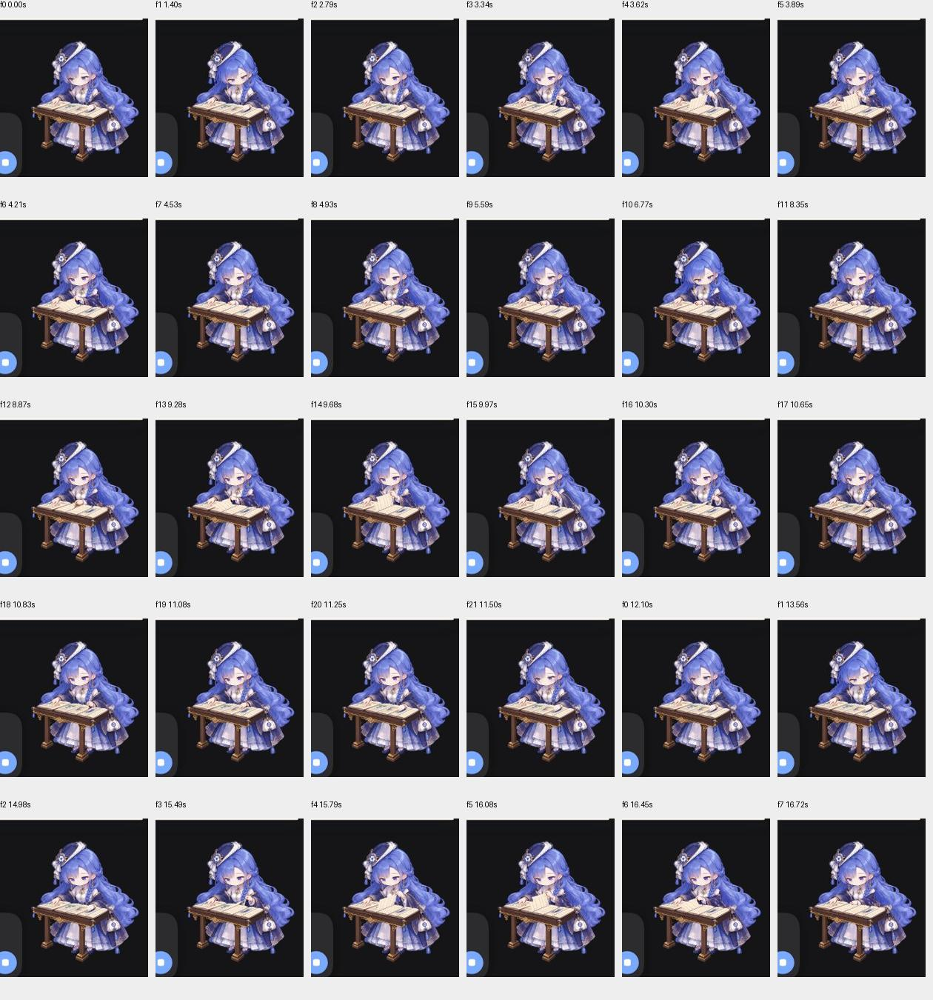

# Kujira 2.3.0 发布测试记录

测试日期：2026-10-28（UTC）。**362 项自动化测试通过；官方 DSH 实际运行验证通过下列功能矩阵。** 以下分别记录自动化测试与 Host 工具调用结果。

## 环境与方法

- 官方 DeepSeek Harness 0.2.1rc2，Linux 云端隔离测试配置；使用真实 GUI、官方 agent-loop、ToolRuntime 和正式 persona / diary 工具。
- 模型端采用无外网的确定性测试适配器，生成固定工具请求；人物、设定和日记均使用合成测试数据。受控模型用于验证插件与真实宿主链路。
- 通过官方插件安装命令调用 PNPM 安装。在线 registry DNS 失败后，本轮使用经原始 `dist.integrity` 校验的官方 npm 公共缓存包及只读本地镜像完成依赖安装。
- `fs-native-extensions 1.5.1` 独立实测：第一把锁成功、同文件第二把锁失败、释放后第二把锁成功。Host 内正式日记写入、读取、摘要更新及落盘产物验证了生产调用路径。
- 安装后 230 个文件与受测包逐字节一致，包含 144 张 PNG。测试适配器、观测器和测试数据不进入发行包；测试结束后卸载临时组件。

## 自动化回归

| 测试组 | 通过 / 总数 | 重点 |
|---|---:|---|
| 原有回归 | 292 / 292 | 日记、设定、状态映射和已有行为 |
| 工具动画防静态回归 | 13 / 13 | 工具运行状态不会退化为静止结果姿势 |
| 独立冻结源审计 | 34 / 34 | 多进程并发、重复操作、跨存储实例、真实文件读写与既有内容保留 |
| 恢复与兼容 | 23 / 23 | 崩溃窗口、损坏回执、部分写入、明确重建及后续正常写入 |
| **合计** | **362 / 362** | **失败 0，取消 0，跳过 0** |

独立测试包含：同一摘要基线的并发写入仅一个提交；12 个进程重试同一操作只产生一份正文；40 次并发追加；Unicode 分页与搜索续读；既有预设的用户修改、删除标记、升级备份与重启保留。恢复测试区分正文缺失与正文被修改，不在读取时擅自恢复删除的正文；明确重建和重复重试分别验证。以上故障注入在模块测试中执行。

## 官方 Host 功能矩阵

共记录 **34 次正式工具结果：29 次正常结果，5 次预期负向拒绝**。每个负向场景检查后续正常操作，而不只判断错误提示。

| 范围 | 实际操作与结果 |
|---|---|
| 设定生命周期 | 创建、导入、绑定、追加、替换、读取、删除、reload 与目录刷新通过；新请求立即反映修改，不依赖重启。解绑后不再注入、文件仍保留，重新绑定恢复。 |
| 内容与隔离 | 46 个既有预设 Markdown 哈希不变；两角色间设定与日记不串用。重复创建、越界路径与替换不存在正文被拒绝。 |
| 日记工具 | 追加、完整读取、搜索、摘要更新与清空通过；短摘要即时注入，长原文不注入；原设定与世界观内容保留。缺少摘要和非法日期被拒绝。 |
| 四种开关组合 | 日记 / 睡眠的关关、开关、关开、开开均通过 GUI 与后续请求验证。日记关、睡眠开时允许整理旧文，但不提供日记工具或摘要注入。 |
| 睡眠整理 | 当天文档不触发整理；旧文 2 段完成。另 12 段旧文处理中由前台抢占，前台运行时不推进，停止后恢复且无重复遗漏。旧原文和当天正文哈希不变。 |
| 双会话任务 | 两会话各 5 个真实工具并发；运行中切换 8 次、后续切换 7 次。24 条状态捕获覆盖思考、工作、回复和完成；角色与当前会话一致，无气泡塌陷或崩溃。 |
| 等待与恢复 | 原生提问呈现等待状态，提交后正常结束；受控失败呈现错误状态，后续请求恢复；停止后可正常继续。 |
| 显示设置 | 深浅主题菜单跟随；形象和气泡独立缩放、隐藏释放占位、全部关闭移除根节点、重新启用恢复；拖动、重置位置、动态选项与仅工作时显示通过。 |

### 千问阅读动画

正式 ToolRuntime 执行合成本地搜索及可取消等待，触发真实 `searching` 状态。共采集 469 张实机帧，其中 383 张处于搜索状态，覆盖 **34.901 秒**；记录 61 次帧转换，0–21 帧顺序循环，跨越两个循环接头（12.099 秒、24.271 秒）。逐组检查观察到正翻页、阅读、回翻与接头顺序正确，没有观察到缺图、错序或持续闪帧。最大采样间隔为 188 ms。

上图是同一次实机采样的局部截图接触表，标注动画帧号与相对时间，展示第一轮与下一轮开始。

### 深浅主题菜单

02:54 UTC，在已安装 2.3.0 的同一官方宿主中复核静态 UI：切换深色和浅色主题，原生右键菜单随主题变化。以下为浏览器直接截取的原始界面区域。

| 深色主题 | 浅色主题 |
|---|---|
|  |  |

## 运行观测

功能矩阵期间宿主没有重启。后端记录 **1 条 `subprocess_weaker_containment` 警告**，表示当前平台子进程树约束能力降低。Cordis error、stderr 写入、process warning 和 uncaught 事件均为 0；未记录 native 加载、锁或日记 I/O 错误标签。

观测始于 02:02:38 UTC；Cordis 有效监测至 02:20:41，进程监测至 02:20:52。清理时先卸载日志观测器，再人工停止宿主，退出码为 130。前端另记录浏览器扩展 metadata 错误，以及主动重启后的连接重试。

## 尚未覆盖

本轮未做 Windows 原生 GUI 实机验证、真实午夜切日、完整 Host 的断电 / 磁盘满 / 跨进程故障注入，以及旧版迁移的 Host 端到端验证。网络请求级失败和长期动画频率也未作完整测量。

## 可核查证据

[结构化测试摘要与受测源文件 SHA-256](v2.3.0-evidence.json) 提供各组计数、原始证据文件的摘要校验值及运行代码指纹。正式文档版仅更新 README，程序、美术与 native 文件和实机受测包逐字节一致；打包后另跑 292 项回归全过。两包 SHA-256 及文件数量见结构化摘要与 Release 校验文件。图像展示对应时刻的实际界面；连续行为记录见上述采样与状态检查。
