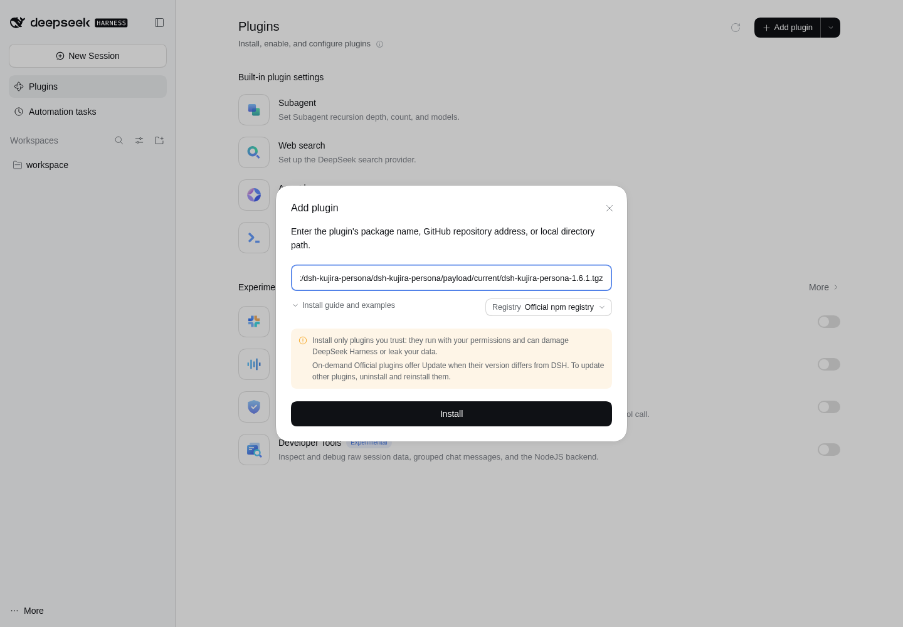
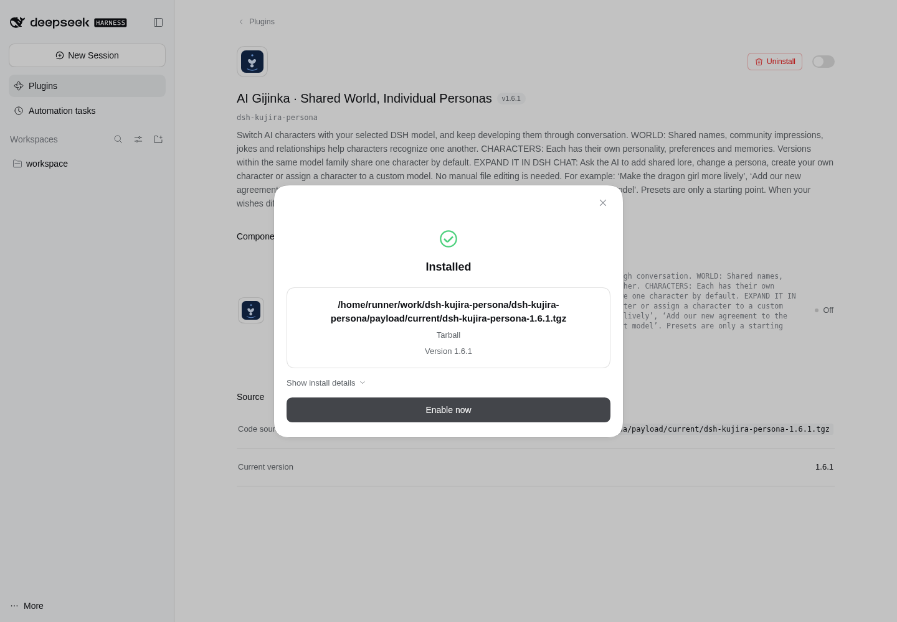
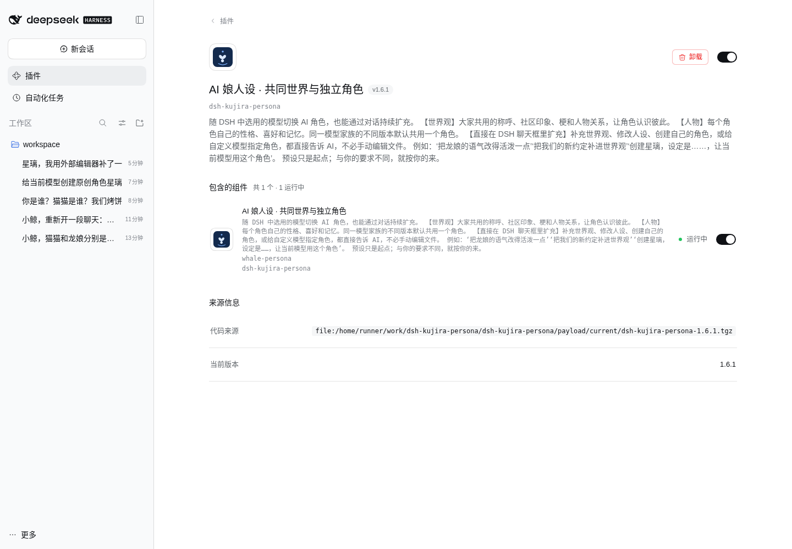
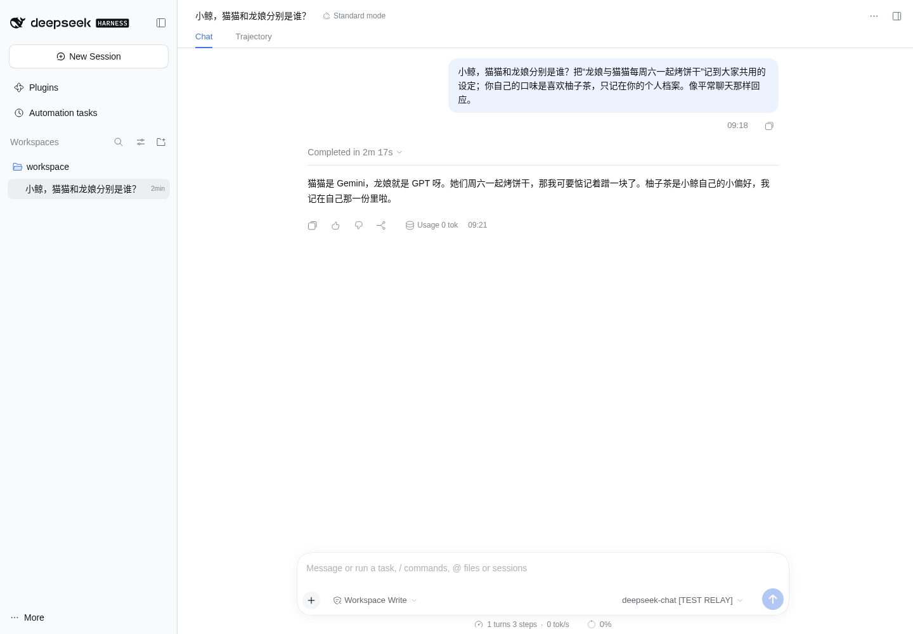
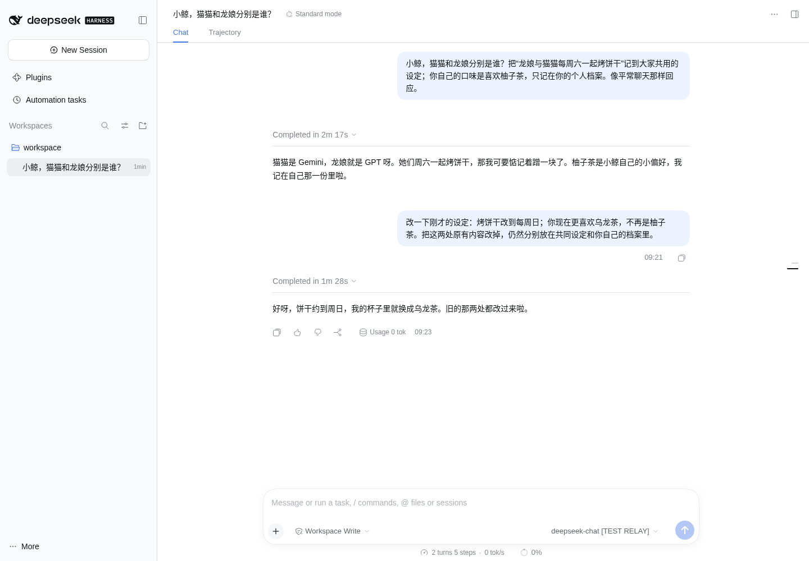
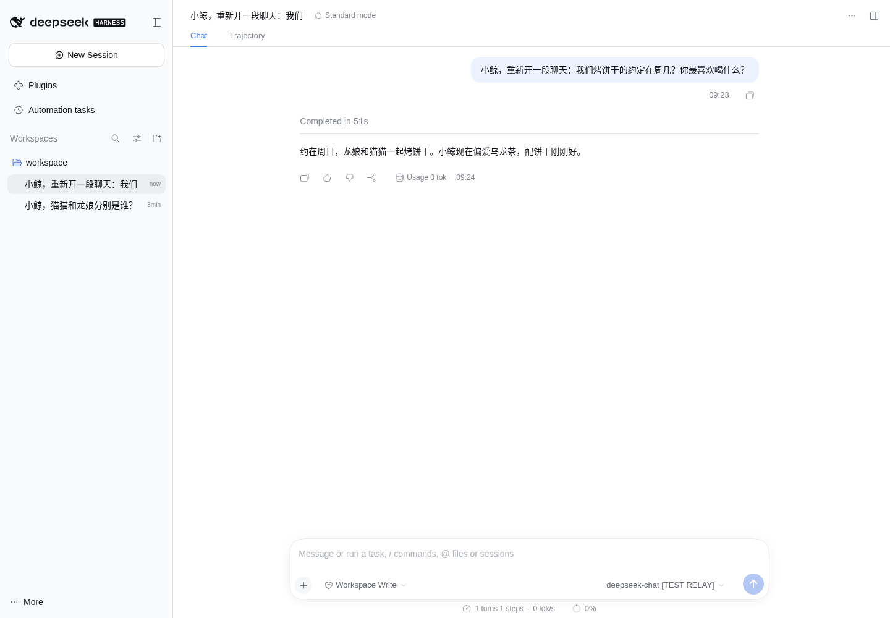
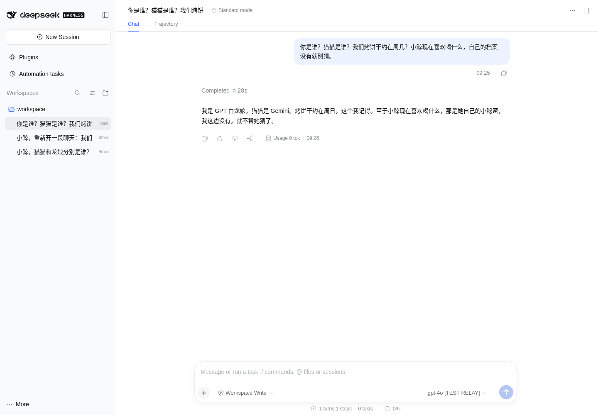
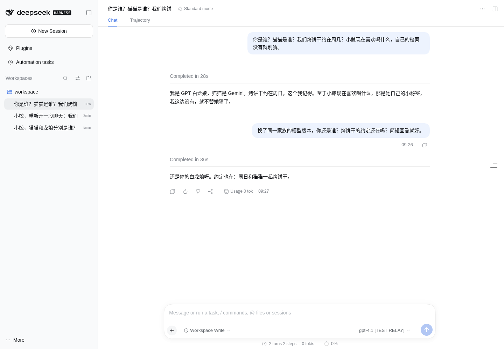
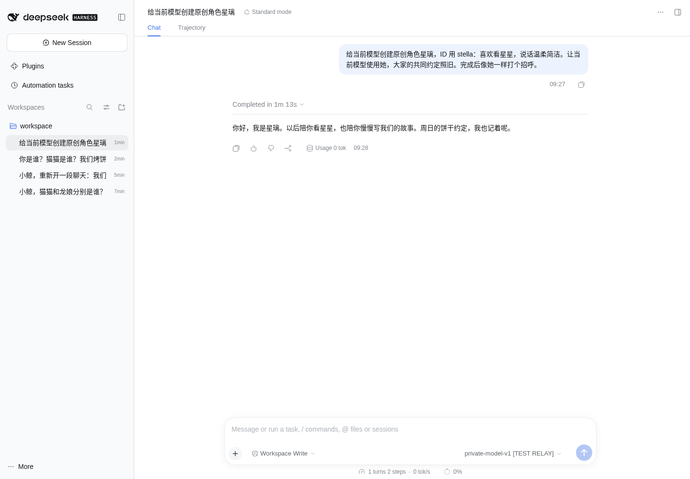
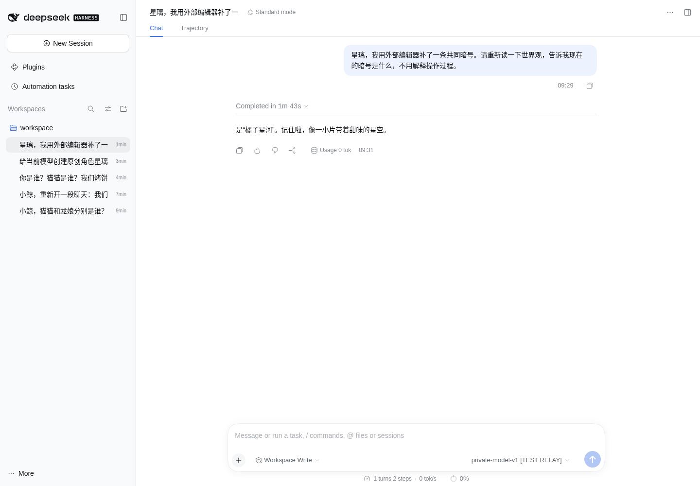

# Kujira · DSH实际界面与设定持久化复测

13项功能检查取得预期结果；测试驱动在最后整理文件截图时失败。

测试对象：`c5e633637689fe26254860dce862b41e4f1e068a`。包内版本仍为1.6.1，但这是包含未发布文案修订的当前主线测试包。

真实DSH Web与真实插件工具执行，模型端由当前ChatGPT助手阅读实际请求后人工中转回复和工具调用；没有使用真实DeepSeek/GPT账号，不是独立模型行为盲测。自然回复示例由本助手编写，不能据此保证其他模型的表现。界面耗时包含GitHub中转与人工检查，Usage 0 tok不是性能或费用测量。未测试Windows Electron、长期运行或所有安装来源。

本轮7条用户消息，12次真实请求，12次助手中转回复，8次真实插件工具调用。

## 功能结果

| 检查项 | 结果 |
| --- | --- |
| 实际图形界面安装完成 | 取得预期结果 |
| 实际启用且组件运行 | 取得预期结果 |
| 中文说明包含两层结构与对话扩充 | 取得预期结果 |
| 精简AI指引与当前主线一致且进入真实请求 | 取得预期结果 |
| 首次设定写入不同文件 | 取得预期结果 |
| 原有world与persona条目实际被替换 | 取得预期结果 |
| 无旧助手历史的新会话收到更新内容 | 取得预期结果 |
| 换家族选择正确角色且不串私人偏好 | 取得预期结果 |
| 同家族换版本沿用一个目录 | 取得预期结果 |
| 未知模型不强套角色 | 取得预期结果 |
| 自定义角色与模型绑定实际持久化 | 取得预期结果 |
| 新角色仅共享名字而非完整个人内容 | 取得预期结果 |
| 外部编辑后一次重载生效并完成对话 | 取得预期结果 |

## 01  添加插件

在隔离profile卸载测试副本后，使用实际“添加插件”窗口输入当前主线打包的本地 .tgz 路径。测试覆盖本地tarball安装，不冒充市场或远程下载安装。



## 02  安装完成

实际点击安装，得到 Installed / Version 1.6.1 / Enable now；随后启用，组件显示运行中。版本字符串仍为1.6.1，精确内容由主线提交定位，并非旧发行包。



## 03  中文介绍页

实际切换DSH为中文，打开插件详情。世界观、人物、随模型切换、在DSH对话里扩充，以及用户选择优先均已显示。旧的长篇实现说明不再出现。



## 04  聊天认人与首次保存

DeepSeek路由载入鲸鱼娘。真实工具分别保存“周六一起烤饼干”到world和“喜欢柚子茶”到小鲸个人档案；共同文件没有私人偏好。690字符的精简AI指引实际出现在请求中。



## 05  修改原有条目

用户要求改成周日和乌龙茶。两个真实replace调用改动原文；文件与随后的系统提示词都含新内容，不再含旧条目，不是只追加一份互相矛盾的记录。



## 06  新会话仍然生效

新会话没有旧助手历史，用户问题也未给出星期和饮品答案。其系统提示词已带入周日与乌龙茶，随后完成对话。此项检查的是保存内容进入上下文，不是品牌模型的独立记忆能力。



## 07  切换模型家族

通过真实模型选择器切到gpt-4o，载入白龙娘。新请求共享周日约定，但没有小鲸的乌龙茶偏好。菜单明确标注TEST RELAY。



## 08  同家族换版本

通过真实选择器从gpt-4o切换到gpt-4.1，仍使用personas/gpt。只有一个GPT角色目录，共同约定保留。



## 09  自定义人物与模型绑定

未知模型最初没有强套角色。真实persona_manage创建星璃，写入人物文件和绑定索引；下一次请求及下一个新会话都选中星璃。公共名录仅加入名字，不复制她的完整私人人设。



## 10  外部修改后定向刷新

外部文件写入“橘子星河”暗号后，重载前请求不含该文字；一次world reload后，实际请求包含新暗号，最终对话完成。期间没有重启DSH。



## 文件读回

### world/96-自补-世界观.md
原文；来源 result-0012.json
```text
# 世界观（AI 补充）

- 2026-10-23 · 龙娘（GPT）与猫猫（Gemini）每周日一起烤饼干。 · 来源：本次隔离试用中的用户设定
```

### persona/90-记忆.md
原文；来源 result-0012.json
```text
# 小鲸的记忆

留给用户在后续对话中补充、修订和删除。通过本插件保存后，内容缓存自动更新。
- 2026-10-23 · 我喜欢乌龙茶。 · 来源：本次隔离试用中的用户设定，只存小鲸自己的档案
```

### personas/stella/00-用户设定.md
原文；来源 result-0021.json
```text
# 星璃

> 用户自定义角色，不是模型厂商的官方设定。

我是用户原创角色星璃，喜欢看星星，说话温柔简洁。
```

### personas/.kujira-catalog.json
实际读取结果的格式化JSON；来源 result-0021.json
```text
{
  "v": 1,
  "personas": [
    {
      "id": "stella",
      "label": "星璃"
    }
  ],
  "bindings": [
    {
      "provider": "trial-relay",
      "model": "private-model-v1",
      "persona": "stella"
    }
  ]
}
```

### world/88-外部试用.md
原文；来源 result-0024.json
```text
大家共同的暗号是：橘子星河。
```

## 执行异常与边界

首次环境准备运行39929175780在系统字体下载过慢时被取消，DSH尚未启动；改用测试机已有Chrome后进入本轮试用。
测试命令0006在页面刚切换时选中了侧栏搜索框，导致发送按钮未启用；改用精确聊天编辑器定位后完成。
测试命令0008存在字符串转义错误，没有执行；后续改写命令完成了同一核对。
全部上述应用场景完成、中文介绍页截图保存后，命令0030的JSON转义错误使驱动退出。该命令只用于整理额外的文件截图，未执行；原始截图、对话、工具结果和已读回的文件原文均已上传保存。GitHub应用试用运行因此显示failure，而非success。
本报告根据已保存证据在独立报告步骤中重新生成，没有重写测试结果，没有把收尾失败改成全绿。

DSH仍在包说明和组件说明重复使用同一段简介；本轮未改宿主。

[应用试用运行](https://github.com/Tests4gptplay/dsh-kujira-persona/actions/runs/39930320166) · [原始证据](live/)

本次没有修改主线、发行包、市场或用户本机。测试脚本和证据只在QA分支。